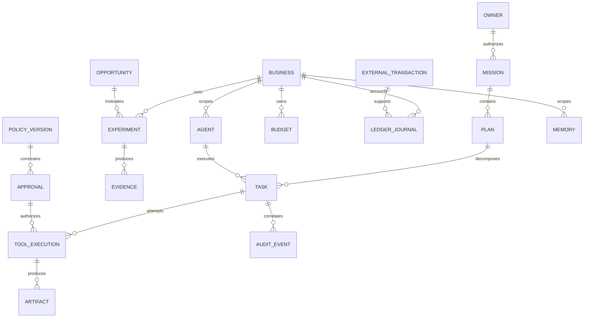

# AUTONOMUS Database Architecture Proposal

**Phase:** P-00 · **Status:** Design only; no database or migrations created  
**Initial preference:** SQLite · **Later option:** PostgreSQL after a measured migration gate

## 1. Persistence principles

- The application services own persistence; arbitrary agents do not receive database credentials or arbitrary SQL tools.
- SQLite is the initial local system of record. PostgreSQL is not a mandatory startup dependency.
- Keep financial truth, forecasts, working state and retrieved knowledge distinct.
- Use versioned migrations, explicit foreign keys, constraints and transaction boundaries.
- Use stable UUID identifiers represented portably; store timestamps in UTC with explicit precision.
- Store money as integer minor units plus ISO currency, or exact decimal representations where required. Never use binary floating point for financial authority.
- Do not add amounts across currencies without an explicit, dated conversion policy.
- Keep secrets outside ordinary tables: store secure-store references only.
- Business isolation is enforced by services and tested permissions. A `business_id` column alone is not a security boundary.

## 2. Initial persistence boundary

P-01 should implement only the core subset needed to prove the OS: users/owner identity, settings, tasks, events, execution records, audit events, schema migrations and a minimal agent registry foundation. Minimum approval/policy and budget-control records must arrive before any corresponding external action; see D-03.

Do not create the full business/financial schema as empty tables merely to appear complete. Add entities when their phase needs them, through migrations.

## 3. Entity catalog

Classification: **I** = internal; **C** = confidential; **R** = restricted. Public source metadata may be public, but owner research context can still be confidential.

| Entity | Purpose | Main relationships | Expected lifecycle | Class | Persistence requirements |
|---|---|---|---|---|---|
| User / Owner | Human identity and administrative authority | Owns missions, approvals, policies | Invited/active/suspended/revoked | R | Durable; credentials external to ordinary profile data |
| Agent | Logical worker identity, not a model process | Parent agent, business, role, tasks | Created→configured→active→paused/reassigned→terminated | C | Durable identity and lifecycle history |
| AgentCapability | Declared, approved capabilities | Agent/role and tool policy | Proposed→approved→revoked/expired | R | Versioned; no self-grant |
| Mission | Owner objective and constraints | Owner, plans, businesses | Draft→authorized→active→completed/paused/closed | C | Durable constraints and authorization snapshot |
| Plan | Structured proposed work | Mission, tasks, decision record | Proposed→approved/rejected→superseded/completed | C | Versioned; preserve original proposal |
| AgentTask | Durable unit of work | Plan, agent, business, execution attempts | Queued→leased→running→waiting/verifying→terminal | C | Lease, idempotency key, status, retry policy |
| Opportunity | Candidate commercial opportunity | Evidence, evaluations, experiments | Discovered→evaluated→selected/rejected/archived | C | Source coverage, uncertainty and duplicate key |
| Evidence | Support for a claim or result | Opportunity, experiment, memory, artifact | Captured→validated/disputed→superseded | C/I | Source URI, capture time, hash, provenance and claim type |
| Business | Independent operating unit | Director, budgets, projects, ledger scope | Constitution business lifecycle | C | Retain records after closure |
| BusinessExperiment | Bounded test of a hypothesis | Opportunity/business, budget, criteria, results | Proposed→approved→running→evaluated→closed | C | Immutable original hypothesis/criteria; versioned amendments |
| Project | Coordinated product/service work | Business, tasks, products, artifacts | Planned→active→delivered/paused/closed | C | Durable checkpoints and ownership |
| Product | Sellable item or service definition | Business, projects, prices, orders | Draft→reviewed→published→retired | C | Versioned deliverables and fulfillment terms |
| Customer | Customer/contact record | Business, orders, support, obligations | Created→active→inactive→retention/erasure review | R | Minimized personal data; lawful retention basis |
| Order / Delivery | Commercial commitment and fulfillment | Customer, product, payment, obligations | Created→confirmed→fulfilled/canceled/refunded | R | Durable external references and delivery evidence |
| FinancialAccount | Verified account/wallet abstraction | Owner/business, transactions, balances | Registered→verified→restricted/closed | R | Secure credential reference; verified balance provenance |
| ExternalTransaction | Provider-reported financial event | Account, order, reconciliation, journal | Observed→verified→reconciled/disputed/reversed | R | Unique provider/event key; immutable source evidence |
| LedgerJournal / Line | Accounting record of verified movements | Account, business, transaction | Posted→reversed by new entry; never overwritten | R | Balanced entries, currency, sequence and audit reference |
| Expense | Cost classification and evidence | Business, journal, supplier, task | Recorded→approved→posted/reconciled/disputed | R | Do not double count commitment and settled payment |
| RevenueRecord | Revenue classification/projection | Business, order, verified transaction | Forecast/invoiced/collected/refunded states kept distinct | R | Collected status requires verified evidence |
| Budget / Reservation | Spending authority and committed capacity | Business/experiment, approvals, tasks | Allocated→reserved→consumed/released/expired | R | Atomic availability checks; reservations are not cash postings |
| Refund / Obligation | Liability and customer commitment | Order, customer, financial events | Open→scheduled→settled/disputed/closed | R | Survive business/agent termination |
| ToolExecution | Authorized tool attempt | Task, agent, policy decision, artifacts | Requested→authorized→running→succeeded/failed/uncertain | C/R | Parameters hash, external reference, idempotency and result evidence |
| Permission / PolicyVersion | Deterministic authority rules | Principal, role, business, tool, resource | Draft→owner-approved→active→revoked/superseded | R | Append-only versions; owner-only administration |
| Approval | Bound human decision for a restricted action | Owner, action hash, policy, budget | Requested→approved/denied→consumed/expired/revoked | R | Amount, recipient, scope, expiry and single-use enforcement |
| AuditEvent | Important action/decision record | Actor, resource, correlation, execution | Append-only; retention/legal hold | R | Tamper-evident sequence; redact secrets |
| Memory | Scoped reusable experience/context | Agent/business/mission, evidence, knowledge version | Captured→validated→active→superseded/expired | C/R | Fact/assumption/prediction label and provenance |
| KnowledgeVersion | Candidate or validated reusable lesson | Memories, experiments, evaluations | Candidate→tested→validated/rejected→retired | C | Preserve basis and measured improvement |
| ModelProfile / Invocation | Routing configuration and usage | Agent/task, provider, model version | Configured→used→deprecated | C | Capability/privacy/cost policy; no credentials in prompts |
| SystemConfiguration | Non-secret application settings | Owner, policy/version references | Proposed→active→superseded/rolled back | C/R | Validate and audit; secret values stored separately |
| EventOutbox / Inbox | Reliable event coordination | Task/event, handler, attempt | Pending→dispatched/processed→failed/reconciled | C | Dedupe keys and retry state |
| Schedule / Lease | Durable future work and ownership | Task/agent/worker | Scheduled→claimed→released/expired/completed | C | Fencing token, heartbeat and recovery state |
| Artifact | File/output reference and integrity | Task/product/evidence/business | Created→validated→published/retired/archived | C/R | Scoped path, hash, size, type and retention class |

## 4. Core relationships

Cardinality is conceptual. A payment may support multiple balanced journal lines; an approval should normally be consumed once. Exact constraints belong in the phase migration, not in this diagram alone.

## 5. SQLite operational strategy

- Enable and test foreign-key enforcement.
- Evaluate WAL mode for reader/writer concurrency; use bounded busy timeouts and short transactions.
- Keep a single controlled write path for financial authorization/allocation.
- Use repository/service interfaces so SQLite-specific behavior does not leak into agent logic.
- Use consistent backup APIs or an approved quiesced backup procedure; do not copy a live database file while ignoring its WAL state.
- Keep the database on a local filesystem. SQLite WAL is not a network-file-system or multi-machine coordination mechanism. [5](https://www.sqlite.org/wal.html)
- Protect database and backup files with owner-only filesystem permissions. Encryption at rest is a separate design decision, not a property implied by SQLite.
- Record the actual SQLite version and relevant pragmas in the Windows environment report.

## 6. Financial truth and accounting proposal

The Constitution requires `Net Profit = Collected Revenue − Refunds − Total Expenses`. That is a useful cash-oriented operating measure, but it is not automatically an accrual accounting profit statement. D-04 requests approval to label and report these separately.

Proposed safeguards:

1. Owner deposits and capital contributions are funding, not sales revenue.
2. Internal transfers and inter-business charges are not new external revenue.
3. A verified external payment event is distinct from an invoice, forecast or model estimate.
4. Refunds, fees, chargebacks and payment reversals remain explicit and reconcilable.
5. Budget reservations prevent concurrent overspending but do not themselves prove an expense occurred.
6. Historical financial events are append-only; corrections use linked reversing/adjusting records.
7. A balanced journal entry has equal debits and credits per currency.
8. Available spend is constrained by verified cash, reserves, liabilities, refund exposure and approved limits—not projected profit.
9. ROI requires a defined invested-capital denominator and period. If the denominator is zero, report undefined/not applicable, not infinity or a fabricated percentage.
10. Simulation events must be segregated and never included in verified live financial totals.

The exact chart of accounts and accrual policy are deferred to P-07 with owner review. Do not implement a payment executor before those definitions and approval tests pass.

## 7. Isolation, privacy and retention

- Scope customer, financial, memory and artifact queries by business and principal.
- Deny cross-business access by default; record explicit sharing grants.
- Minimize personal data in research and model prompts.
- Keep credentials and private keys out of tables, logs, embeddings and backups of prompts.
- Define retention classes for financial records, customer obligations, research, working memory and audit logs.
- Business closure does not authorize deletion of legally required records or outstanding obligations.
- Erasure requests must be evaluated against legal hold/retention requirements; no universal retention period is invented here.

## 8. Migration path to PostgreSQL

Trigger a migration review when measured concurrency, data size, remote-node requirements or operational availability exceed the local SQLite design. Do not migrate merely because the vision is large.

Migration steps:

1. Define dialect-neutral domain types and repository contracts.
2. Test UUID, timestamp, JSON, decimal/money, constraint and transaction behavior on both engines.
3. Add PostgreSQL migrations and integration tests without changing domain semantics.
4. Take a verified backup and rehearse restore.
5. Quiesce writers, migrate data and validate row counts, key relationships and financial balances.
6. Reconcile ledger totals and replay/idempotency state before cutover.
7. Run a controlled cutover with a documented rollback plan.
8. Keep one authoritative writer during transition; avoid ad hoc dual writes.

## 9. Future validation gates

- Migration upgrade and restore tests.
- Concurrent budget reservation and approval-consumption tests.
- Duplicate provider-event and task-retry tests.
- Business-isolation and unauthorized-query tests.
- Ledger balance, refund, fee, chargeback and multi-currency tests.
- Crash recovery around task lease, outbox and external side effects.
- Backup integrity, restore time and retention/legal-hold tests.

No database correctness, performance or security test is claimed as passed in P-00 because no application database exists yet.
