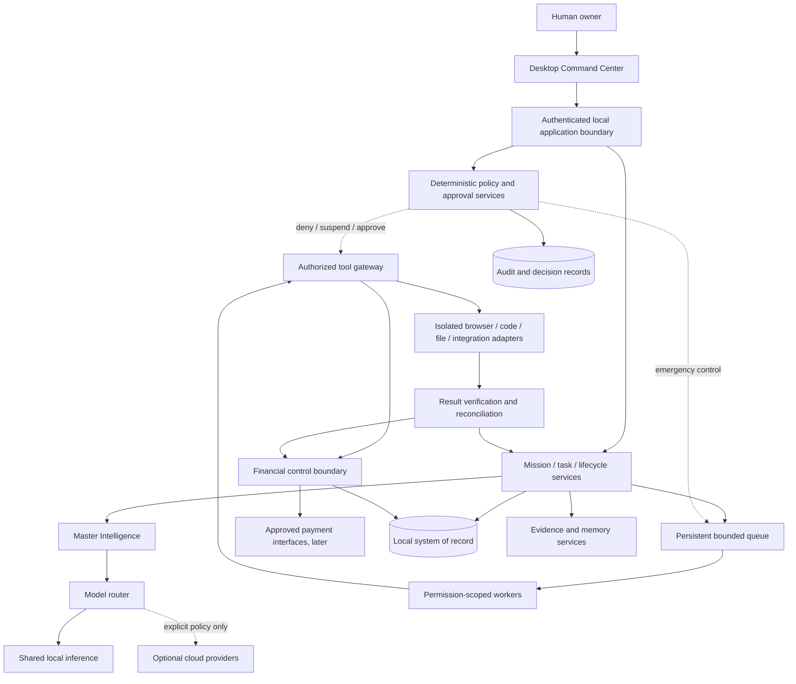

# AUTONOMUS System Architecture Blueprint

**Phase:** P-00 · **Status:** Proposed architecture for review; no application implemented  
**Authority:** Master Constitution v1.0 and Prompt Pack v1.0  
**Open approvals:** [OPEN_DECISIONS.md](../OPEN_DECISIONS.md)

## 1. Architectural intent

AUTONOMUS is a Windows-first business operating environment, not an unrestricted desktop agent. Its unit of success is a complete, authorized business workflow with verified outcomes. Intelligence proposes; deterministic services authorize, execute, record and verify.

Owner-locked decisions remain unchanged: hybrid local-first AI, controlled autonomy and Windows-first delivery. The following are engineering proposals within those decisions, not new owner approvals.

### Recommended initial shape

A **modular local application** with explicit service boundaries:

- A thin Tauri desktop shell and React/TypeScript interface.
- A local Python/FastAPI application boundary.
- Application services for missions, agents, businesses, finance and governance.
- A persistent task queue and bounded workers in the same initial deployment.
- SQLite as the initial local system of record.
- A shared local inference service behind provider adapters.
- Separate, restricted execution environments for untrusted tools.

Do not begin with microservices, distributed agents, a mandatory vector server or a separate model process per agent. Extract services only when measured workload, isolation or deployment requirements justify it.

## 2. System context



The diagram is a design, not a claim that these services exist.

## 3. Component catalog

### 3.1 Core Operating System

- **Responsibility:** Lifecycle, configuration, owner authentication, local API, persistent tasks, events, health and recovery.
- **Inputs:** Owner commands, configuration, task requests, worker heartbeats, shutdown signals.
- **Outputs:** Validated commands, durable task/event records, health status, recovery decisions.
- **Dependencies:** Persistence, governance, logging; no dependency on cloud AI for startup.
- **Interfaces:** Authenticated local API; internal application-service interfaces; durable event/outbox records.
- **Security boundary:** Validates caller identity and request schemas; never trusts a UI label or agent role string as authorization.
- **Data:** Users, settings, missions, tasks, execution attempts, events, audit references.
- **Future integration:** Remote monitoring and authenticated execution nodes through explicit gateways, not direct database sharing.

### 3.2 Master Intelligence Engine

- **Responsibility:** Interpret missions, propose plans, decompose work, coordinate agents and explain evidence-backed decisions.
- **Inputs:** Authorized mission, portfolio state, retrieved evidence, resource budgets, policy constraints.
- **Outputs:** Structured plans, task proposals, decision summaries, clarification requests and result assessments.
- **Dependencies:** Model router, context/memory service, task service, policy service.
- **Interfaces:** Typed plan/action proposals; no direct wallet, shell or arbitrary database access.
- **Security boundary:** Untrusted model output. It cannot grant permissions, verify its own payments or change governance.
- **Data:** Missions, plans, decision records, context references and verification outcomes.
- **Future integration:** Replaceable reasoning providers and specialized executive agents.

### 3.3 Opportunity Discovery Engine

- **Responsibility:** Discover and evaluate legitimate opportunities within a declared source coverage set.
- **Inputs:** Search policies, authorized connectors, market signals, prior experiments and budget limits.
- **Outputs:** Opportunity records, evidence links, competitor analysis, estimates, scores, uncertainty and risk gates.
- **Dependencies:** Research tools, source provenance service, scoring service, memory.
- **Interfaces:** Read-only connector requests; structured opportunity/evidence writes through application services.
- **Security boundary:** Web content is untrusted data; source instructions cannot create tasks with elevated authority.
- **Data:** Opportunities, evidence, evaluations, duplicates, source coverage and rejection reasons.
- **Future integration:** Additional authorized marketplaces/APIs; no claim of exhaustive internet coverage.

### 3.4 Dynamic Agent Factory

- **Responsibility:** Create and govern specialized logical agents within quotas and resource budgets.
- **Inputs:** Approved workload, parent request, role template, capacity and business budget.
- **Outputs:** Agent identity, scoped configuration, lifecycle events and capacity decisions.
- **Dependencies:** Governance, resource monitor, registry, model profiles and task service.
- **Interfaces:** Agent creation/pause/reassign/terminate commands; no self-service permission editing.
- **Security boundary:** Factory enforces parent scope, depth, quota and budget; descendants cannot exceed ancestors.
- **Data:** Agents, capabilities, parent relationships, permissions, budgets, lifecycle and performance.
- **Future integration:** Shared service teams and authenticated remote workers.

### 3.5 Universal Digital Execution Engine

- **Responsibility:** Execute authorized digital work through controlled adapters.
- **Inputs:** Authorized task, scoped tool request, validated parameters, execution budget and cancellation token.
- **Outputs:** Artifacts, observations, execution records, errors and verification evidence.
- **Dependencies:** Tool gateway, policy, isolated environments, secrets broker and artifact store.
- **Interfaces:** Official APIs first; structured automation second; browser third; desktop fallback last.
- **Security boundary:** Separate research browser from authenticated sessions; sandbox code; restrict files, commands and network.
- **Data:** Tool executions, attempts, artifacts, external references and result hashes.
- **Future integration:** New adapters without giving agents general host control.

### 3.6 Business Creation Engine

- **Responsibility:** Convert validated opportunities into governed business workspaces and complete workflows.
- **Inputs:** Approved opportunity, business template, budget, product definition and channel authorization.
- **Outputs:** Business plan, products, offers, orders, delivery records, support cases and lifecycle proposals.
- **Dependencies:** Execution, agents, finance, customer records and governance.
- **Interfaces:** Business-scoped commands and events; approved publishing/distribution adapters.
- **Security boundary:** Business isolation; customer communication and publication require explicit channel permissions.
- **Data:** Businesses, experiments, projects, products, customers, orders and obligations.
- **Future integration:** Storefronts, subscription services and inter-business contracts.

### 3.7 Financial Intelligence Engine

- **Responsibility:** Maintain financial truth, budgets, approvals, reconciliation and capital controls.
- **Inputs:** Verified provider events, approved commitments, expense evidence, refund events and owner funding records.
- **Outputs:** Reconciled balances, cash results, profit views, budget availability, exposure and financial reports.
- **Dependencies:** Governance, immutable ledger, provider adapters and reconciliation service.
- **Interfaces:** Read-only financial queries; separately authorized payment commands; no model-held credentials.
- **Security boundary:** Deterministic limits and approval verification; AI forecasts cannot become collected revenue.
- **Data:** Accounts, external transactions, journal entries, budgets, reservations, expenses, refunds and liabilities.
- **Future integration:** Additional payment providers and consolidated multi-business reporting.

### 3.8 Survival and Scaling Engine

- **Responsibility:** Evaluate business and agent outcomes and recommend/execute authorized lifecycle changes.
- **Inputs:** Reconciled results, experiment criteria, workload, quality, risk and resource measurements.
- **Outputs:** Continue/optimize/scale/pause/close proposals and authorized transitions.
- **Dependencies:** Finance, business records, agent metrics, factory and governance.
- **Interfaces:** Lifecycle decision commands with evidence and policy checks.
- **Security boundary:** Cannot retire essential security/audit infrastructure or erase obligations to improve metrics.
- **Data:** Evaluations, experiment outcomes, scaling decisions and closure checklists.
- **Future integration:** Portfolio optimization after sufficient real evidence exists.

### 3.9 Memory and Continuous Learning Engine

- **Responsibility:** Preserve working state and evidence-backed experience; retrieve relevant knowledge.
- **Inputs:** Verified outcomes, experiment hypotheses, decisions, artifacts and validated lessons.
- **Outputs:** Scoped context, retrieval results, experiment comparisons and candidate improvements.
- **Dependencies:** Persistence, provenance, retrieval adapter and evaluation service.
- **Interfaces:** Business/agent-scoped reads and writes; no direct cross-business memory access.
- **Security boundary:** Retrieved content is untrusted; facts, predictions and assumptions remain distinct.
- **Data:** Memories, evidence references, knowledge versions, validation status and retention policy.
- **Future integration:** Local embeddings/vector store after benchmark; shared knowledge with explicit authorization.

### 3.10 Security and Governance Engine

- **Responsibility:** Enforce identity, permissions, approvals, financial authority, audit and emergency controls.
- **Inputs:** Authenticated principals, policy versions, action requests, risk classifications and owner decisions.
- **Outputs:** Allow/deny/require-approval decisions, scoped grants, revocations and audit events.
- **Dependencies:** Owner identity, secure configuration and audit storage; must not depend on model availability.
- **Interfaces:** Mandatory pre-action policy checks and post-action recording; owner-only policy administration.
- **Security boundary:** Deterministic authority independent of intelligence and business objectives.
- **Data:** Permissions, approvals, policy versions, audit events, revocations and emergency state.
- **Future integration:** Stronger isolation, hardware-backed credentials and authenticated remote nodes.

### 3.11 Command Center Interface

- **Responsibility:** Expose status, evidence, approvals and owner controls.
- **Inputs:** Backend queries/events and authenticated owner commands.
- **Outputs:** Validated commands, approval decisions and accessible views.
- **Dependencies:** Local API and desktop shell.
- **Interfaces:** Typed API/IPC; no arbitrary shell command field or direct financial credential access.
- **Security boundary:** UI is not trusted merely because it is local; restrict Tauri capabilities and validate at the backend.
- **Data:** UI preferences only; authoritative metrics remain backend-owned.
- **Future integration:** Remote monitoring through a separately authenticated interface.

### 3.12 Autonomous Operations Engine

- **Responsibility:** Durable scheduling, retries, recovery, monitoring and bounded continuous operation.
- **Inputs:** Schedules, events, task leases, health checks and operating mode.
- **Outputs:** Eligible task dispatch, retry/escalation decisions, reports and recovery actions.
- **Dependencies:** Core queue, governance, execution state and resource monitor.
- **Interfaces:** Scheduler and workflow commands; idempotent handlers.
- **Security boundary:** Cannot self-elevate operating mode; emergency state survives restart.
- **Data:** Schedules, leases, attempts, outbox/inbox, checkpoints and recovery records.
- **Future integration:** Distributed dispatch only after authenticated node and idempotency design.

### 3.13 Multi-business Coordination Engine

- **Responsibility:** Coordinate independent businesses, shared services and portfolio resource allocation.
- **Inputs:** Business requests, authorized shared-service contracts, budgets and consolidated reports.
- **Outputs:** Cross-business tasks, internal service charges and portfolio decisions.
- **Dependencies:** Business isolation, finance, governance and shared resource management.
- **Interfaces:** Explicit inter-business contracts; no shared unrestricted memory or database credentials.
- **Security boundary:** Cross-business access is denied by default; internal transfers are not external revenue.
- **Data:** Portfolio relationships, contracts, allocations, shared-service usage and eliminations.
- **Future integration:** Agent/service marketplace and multiple execution machines.

## 4. Communication and data contracts

Use explicit application interfaces rather than agents importing one another's internals.

A conceptual action envelope contains:

```json
{
  "command_id": "uuid",
  "correlation_id": "uuid",
  "actor_id": "authenticated principal",
  "business_id": "optional scoped business",
  "action": "registered action name",
  "resource": "registered resource identifier",
  "payload_hash": "hash of canonical validated payload",
  "idempotency_key": "stable across retries",
  "policy_version": "version used for authorization"
}
```

This is a schema proposal, not an implemented API. Credentials and private keys never belong in this envelope.

Events carry schema version, event ID, occurrence time, producer, correlation/causation IDs and scoped payload references. Store large artifacts separately with hashes and access controls. Decision records contain a concise rationale, evidence references, alternatives and policy result—not hidden model chain-of-thought.

## 5. Primary workflow

1. Owner initializes a mission, resources, permissions and operating mode.
2. Discovery records evidence and source coverage.
3. Intelligence proposes an experiment with hypotheses, costs and success criteria.
4. Policy checks eligibility, budget, risk and approval requirements.
5. Durable tasks are assigned to scoped agents/workers.
6. Tool gateway executes only authorized actions and records attempts.
7. Deterministic checks verify artifacts and delivery; customer/value outcomes are recorded separately.
8. Financial services reconcile verified provider events; forecasts remain separate.
9. Survival/scaling evaluates results against predefined criteria.
10. Memory stores validated lessons and unresolved uncertainty.
11. Owner can inspect, pause, revoke or shut down at any point.

## 6. Trust boundaries

1. Owner/UI ↔ local application: authentication, schema validation, origin/IPC restrictions.
2. Application ↔ model: model output is an untrusted proposal.
3. Research content ↔ application: provenance, sanitization and no instruction authority.
4. Worker ↔ host: OS-level isolation, scoped files/network and resource limits.
5. Business ↔ business: explicit authorization and scoped queries.
6. Application ↔ payment provider: isolated credentials, deterministic approval and reconciliation.
7. Local node ↔ future remote node: authenticated transport, node identity and replay protection.

A prompt delimiter, role name or Python subprocess is not a security boundary by itself.

## 7. Recovery and side-effect discipline

- Persist task intent and authorization before external execution.
- Use leases and fencing/attempt identifiers to detect stale workers.
- Use an outbox/inbox pattern where database state and event dispatch must coordinate.
- Assume at-least-once delivery; design idempotent handlers. Do not claim exactly-once external effects.
- For providers without idempotency, record intent, query external state before retry and reconcile ambiguous outcomes.
- Never blind-retry a payment, publication, email or order because a model call timed out.
- On restart, recover durable state, revoke stale leases and reconcile uncertain external actions before resuming.
- Emergency mode remains active after restart until the owner explicitly changes it.

## 8. Deployment and scaling

Initial deployment is one Windows owner machine. The production local API should bind to loopback and authenticate callers; development preview settings must not become production defaults. Ollama is a shared local service, not a public network endpoint.

Scale in this order: improve queues and model routing; measure SQLite and worker contention; add isolated local workers; introduce PostgreSQL/remote nodes only when required. SQLite WAL is not a shared network database. Multi-machine operation requires a new transport, identity and reconciliation design.

## 9. Architecture acceptance gates

- P-01 proves local startup/shutdown, authentication, migrations, durable tasks and minimum policy/audit controls on Windows.
- P-02 proves a bounded mission with authorized tool proposals and verified results.
- P-03 proves the opportunity pipeline end to end **under absence of sources**: discovery, screening, refusal-first acquisition, evidence epistemics, commercial feasibility, risk and governance, scoring, the validation ladder, and nine-section reporting. It does **not** prove live source acquisition — no market source is reachable from the build environment, so `default_source_catalog()` ships empty and the egress allowlist defaults to deny-all. See [ADR-0018](../decisions/ADR-0018-NO-INVENTED-MARKET-DATA.md) and [OPPORTUNITY_PIPELINE.md](OPPORTUNITY_PIPELINE.md).
- P-05 proves isolated execution and safe failure behavior.
- P-07 proves financial reconciliation and restricted transaction authority.
- P-12 proves restart/retry without duplicate external effects.
- P-14/P-15 prove integration and target-hardware reliability.
- The master business acceptance test remains unfulfilled until a real authorized end-to-end business cycle is demonstrated.

No component in this blueprint is represented as implemented by P-00.
